# 🎮 WatchDogsGo — KG Edition

<p align="center">
  <strong>📡 MeshCore + Meshtastic &nbsp; · &nbsp; 🛰️ Local AUTO GPS &nbsp; · &nbsp; 🔁 WiFi + BLE wardriving</strong><br>
  <strong>💬 Off-grid chat &nbsp; · &nbsp; 🗺️ Mesh discoveries &nbsp; · &nbsp; 📤 WDGWars sync</strong>
</p>

<p align="center">
  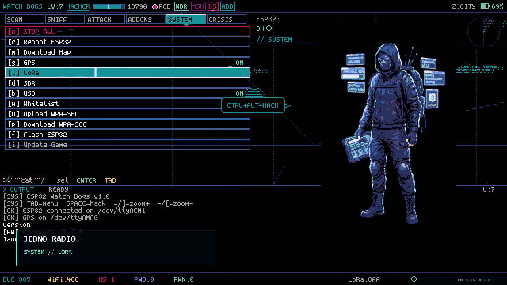
</p>

<p align="center"><em>🕶️ Pocket cyberdeck. Big ears. The original WDG, with KiloGramowy's mesh and wardriving improvements.</em></p>

## ✨ What's new in KG Edition?

**Two mesh worlds. One familiar WDG interface.** This fork adds Meshtastic beside MeshCore, local GPS-based RF profile recall and alternating WiFi/BLE wardriving — while preserving the game's menus, artwork, keyboard controls and saved progress.

| | Our additions and improvements |
| --- | --- |
| 📡 **Choose your mesh** | Select **Meshtastic or MeshCore** when enabling LoRa; the HUD follows the protocol actually running. |
| 💬 **Chat in the WDG style** | Separate **MeshCore Chat** and **Meshtastic Chat**, with saved local nickname and history. |
| 🛰️ **Local AUTO GPS** | Recall an explicitly approved local RF profile, independently for each protocol. |
| 🗺️ **Mesh discoveries** | Recognize Meshtastic NodeIDs and use the existing contacts, map, loot and XP systems. |
| 📍 **Receiver GPS fallback** | Retain a measured observation position when a mesh contact has no valid coordinates of its own. |
| 🔁 **WiFi + BLE wardriving** | Both ON: complete scan/save cycles take turns automatically. |
| 🔧 **Startup and recovery fixes** | Better device selection, truthful errors, safe scan handover and GPS UART retry. |
| 📤 **Upload fixes** | Persistent server receipts, meaningful pending counts and pruning of empty/invalid queue exports. |
| 🔋 **Clean exit** | Stop WDG's operations, save the last records and switch off hardware acquired by the game — USB last. |
| 🔔 **Quiet update notices** | Check this fork at startup; show one notice per approved release, with full notes in **SYSTEM → Update Game**. |

## 🎬 Watch it on uConsole

**🔊 Press Play, then unmute with the speaker icon for the full 100-second demo with the selected Infraction / Venom soundtrack.** GitHub starts the player muted.

https://github.com/user-attachments/assets/498dfb34-79a6-4067-8d6a-e5e206c29b02

▶️ **[Open / download the full-quality film](docs/media/demo.mp4)** · 🎞️ **[Media details and soundtrack credit](docs/media/README.md)**

The film shows the startup theme, WDG launch, protocol selection, both chats, contacts and a historical upload confirmation. The boot segment recreates the installed Plymouth theme; the WDG launch is recorded footage. Later AUTO GPS and WiFi/BLE changes have their own screenshots below. Exact GPS and credentials are hidden; public conversations and nodes remain visible.

### 🚀 Starting WatchDogsGo

| 🖥️ WDG starts | ✅ System check and loading |
| --- | --- |
| 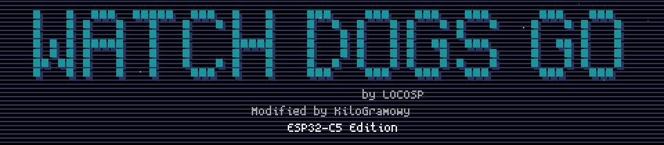 | 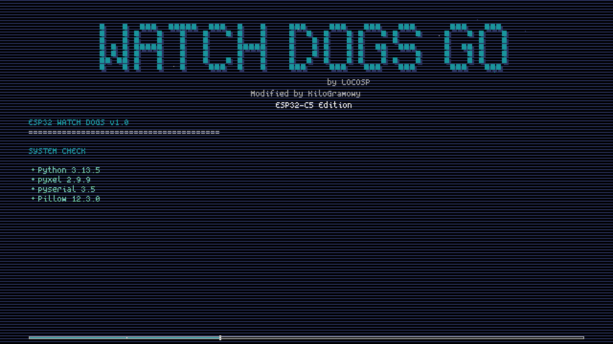 |

*Recorded WDG launch and loading sequence. The personal uConsole boot theme in the film is separate from the game installer.*

## 📡 1. Choose MeshCore or Meshtastic

Open **SYSTEM → LoRa → ON**. Choose **Meshtastic** on the left or **MeshCore** on the right with **← / →**, then press **Enter**. MeshCore is highlighted by default.

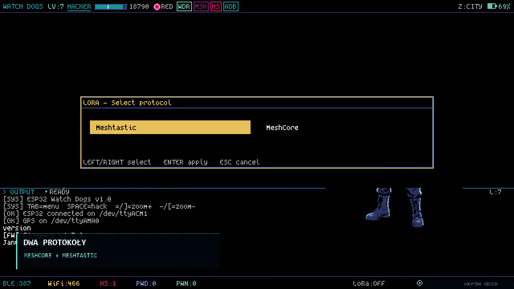

<p align="center">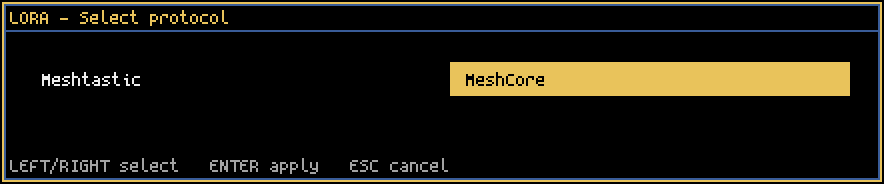</p>

🎞️ **The selector in action:**

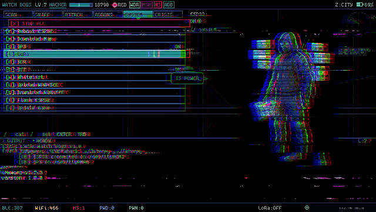

- 🎛️ **You choose the protocol.** GPS never switches MeshCore/Meshtastic for you.
- 📻 **One SX1262, one active protocol.** No automatic time slicing between mesh protocols.
- 🟢 **Status follows the real radio state.** A highlighted menu row alone does not mean the radio started.
- 🛑 **LoRa OFF stops the active receiver.**

## 💬 2. Two chats, the same familiar interface

Open **ADDONS → MeshCore Chat** or **ADDONS → Meshtastic Chat**. Opening the other chat switches the shared radio. Your local nickname is saved between launches.

### 📻 MeshCore Chat

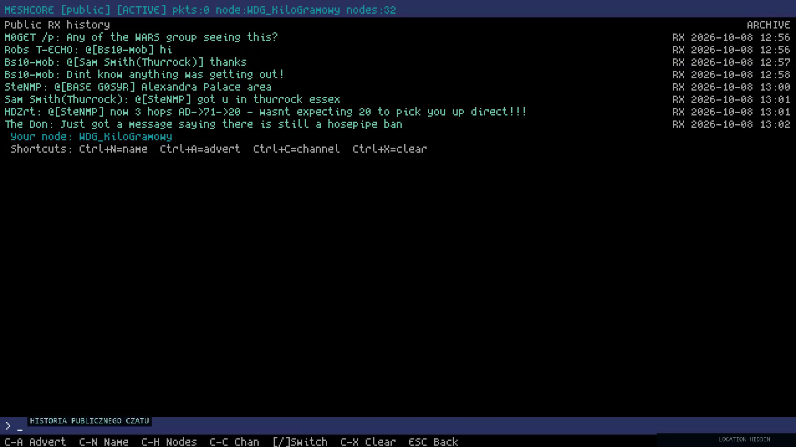

The existing MeshCore messenger, channel selection, private channels and direct-message functionality are retained.

### 📡 Meshtastic Chat

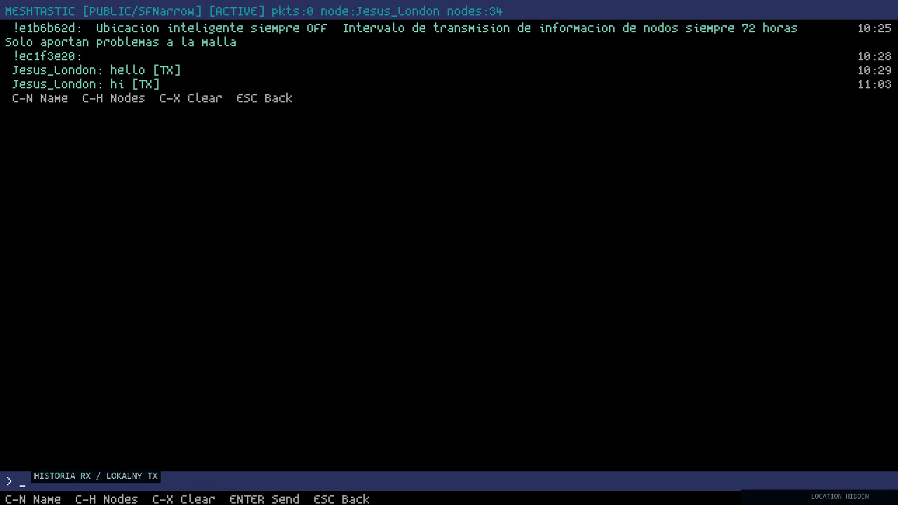

Meshtastic adds **public text RX/TX, NodeInfo and position reception**, persistent contacts and history. It currently uses one selected public channel at a time. Private Meshtastic channels and DMs are not included; the saved local nickname is not automatically advertised as NodeInfo.

📨 **TX_DONE confirms local transmission completion; a saved or queued message alone does not. Neither proves delivery to another device.**

## 🗺️ 3. Close the chat. Keep discovering.

Press **Esc** to return to the main WDG screen. The selected mesh receiver keeps listening in the background — the chat can stay closed.

*Your chat window can take a break. The receiver stays on duty.* 📻

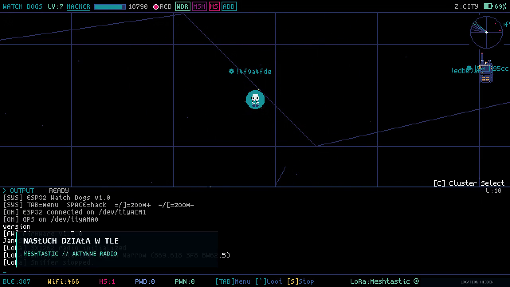

### 🧭 Real NodeIDs and persistent contacts

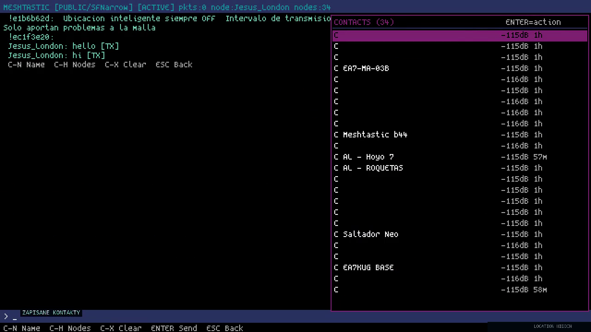

- 🔎 Recognize supported Meshtastic packets, rather than treating arbitrary bytes as nodes.
- 💾 Retain discoveries across restarts and deduplicate repeat packets.
- ⭐ Use the existing **20 local XP per new persistent mesh discovery** rule. Retransmissions, repeats and GPS repairs earn no second discovery award.
- 📍 Prefer valid **Node GPS**. Otherwise use a fresh measured uConsole fix as **Receiver GPS**, preserving its origin.

Receiver GPS describes an observation or a later measured receiver-position assignment, not the remote node's true location. Without a credible fix, recoverable contacts wait for GPS. A packet's `from` NodeID identifies its declared author; a relay may have delivered the frame.

## 🛰️ 4. MANUAL profiles + local AUTO GPS

**Choose your protocol. Let GPS recall the RF profile you approved for that area.**

GPS knows where you are. It still needs you to tell it what the local mesh is listening to. 🧭

Open **ADDONS → Meshtastic Profile** or **ADDONS → MeshCore Region**. Each protocol has its own RF catalog and saved assignments. Chat channels and keys remain separate from frequency/BW/SF/CR.

### 📡 Meshtastic profiles

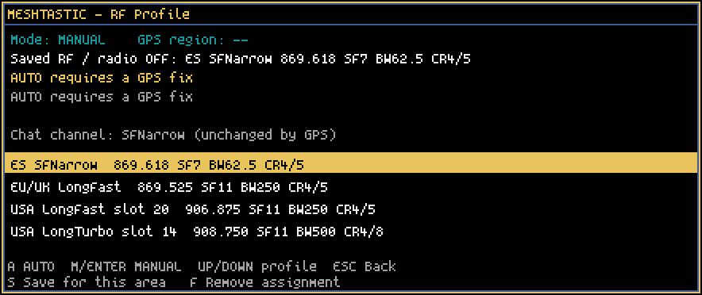

### 📻 MeshCore profiles

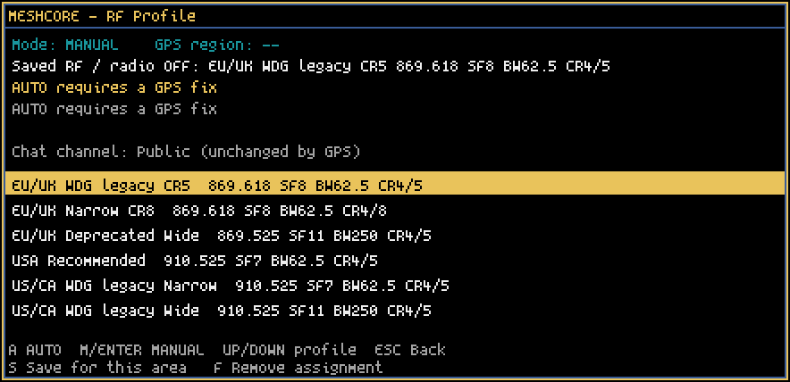

### 🧭 Set up a local AUTO profile

1. 📡 **Choose MeshCore or Meshtastic manually.**
2. 🎛️ **Choose a known local profile** with **↑ / ↓**, then **M / Enter** for MANUAL. With LoRa OFF this saves the selection; check **Active RF** when it is running.
3. 🛰️ **Wait for a fresh, stable GPS fix.** After a successful manual selection, press **S** for **Save for this area**.
4. 📍 **Check the protocol, profile and displayed 2 km circle.** Press **Y** to approve, or **N / Esc** to cancel. Selecting a profile alone never creates an approval.
5. ✅ **Press A to enable AUTO GPS.** Saving an assignment does not enable AUTO by itself.

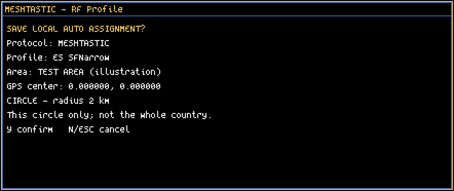

*🖼️ Save-dialog preview from the actual WDG drawing code, using test data; no real fix or approval was created. The two profile-menu captures above are from the running uConsole application.*

| Situation | What WDG does |
| --- | --- |
| ✅ Stable fix inside a matching approved area | AUTO can recall that protocol's saved RF profile. |
| 🧭 No assignment or ambiguous match | Keep active RF settings and offer a manual choice. |
| 🛰️ GPS fix is lost | Keep the active profile and show lost GPS confirmation. |
| 🎛️ MANUAL selected | Keep your choice; GPS does not overwrite it. |
| 🗑️ **F**, then **Y** | Remove the displayed local assignment without deleting contacts, keys or progress. |

📌 **Local means local.** An approval covers the displayed circle, not an entire country. AUTO uses its conservative inner area and does not discover nearby nodes' RF settings. RF changes preserve channel/key configuration.

🇪🇸 **Real Meshtastic SFNarrow traffic was received around San Fernando:** EU_868, **869.618 MHz · BW 62.5 kHz · SF7 · CR 4/5**. This does not establish one preset for all Spain or for MeshCore. EU/UK LongFast remains available; MeshCore has its own catalog.

📚 **[Complete RF profiles, GPS checks and sources →](docs/RADIO_PROFILES.md)**

## 🔁 5. WiFi + BLE: automatic scan intervals

In **SNIFF**, turn **WiFi Wardrive ON** and **BT Wardrive ON**. One selected mode runs alone; both selected modes take turns.

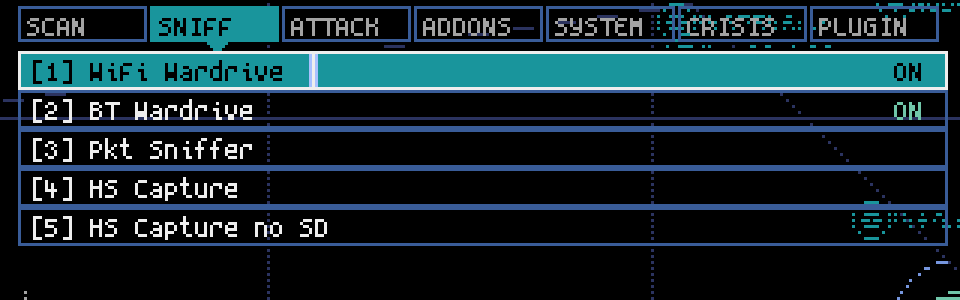

### 📶 WiFi → 💾 save → ⏸️ pause / confirmed STOP → 🔵 BLE → 💾 save → 🔁 repeat

| WiFi | BT | Result |
| --- | --- | --- |
| 🟢 ON | ⚫ OFF | Repeated complete WiFi scans |
| ⚫ OFF | 🟢 ON | Repeated complete BLE scans |
| 🟢 ON | 🟢 ON | Alternating complete WiFi and BLE cycles |
| ⚫ OFF | ⚫ OFF | Schedule stopped |

One ESP32 runs one phase at a time. Adding the second mode waits for the current scan to finish. Each completed phase keeps the existing two-second pause; switching waits for the firmware's final STOP acknowledgement. **STOP ALL** or another manually selected ESP32 operation cancels the schedule.

📡 LoRa uses the separate SX1262 and can keep receiving alongside wardriving. Packet sniffer and HS capture remain separate operations.

## 🔧 6. More dependable starts and clearer errors

- 🔌 **Better ESP32 selection:** avoid choosing an unrelated USB ACM device just because it appears first.
- 🟢 **Truthful start reporting:** failed commands produce errors, rather than a false running state.
- 🔁 **Safer handover:** clear stale timers and prevent late STOP replies from restarting cancelled work.
- 💾 **Save before switching:** failed completion, storage or STOP confirmation pauses the schedule.
- 🛰️ **GPS UART recovery:** retry the configured UART when NMEA data starts after the initial probe.

## 📤 7. Uploads that account for the real result

Collecting pending uploads should not be an extra side quest. 🧾

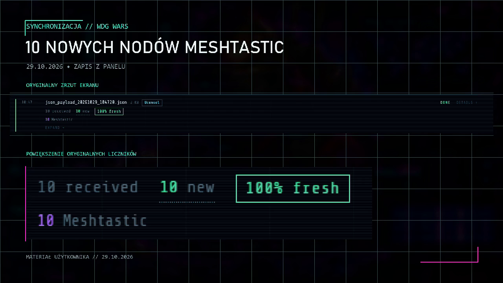

- 🧾 **Check application receipts**, including imported, known, cooldown-handled, rejected and unresolved records. HTTP 200 alone is not enough.
- 💾 **Keep receipts across restarts**, bound to the supported payload, account and endpoint.
- 🧹 **Prune empty/invalid queue exports**, retaining authoritative contacts, XP and valid recoverable mesh data.
- 🔢 **Pending counts sessions, not nodes.** New observations in an open session can create another pending payload.
- ⭐ **Local XP and server credit stay separate.** Known nodes and cooldown handling do not become new imports or first-finder ownership.

*The image is the original dated upload confirmation, not a new upload performed for this README.*

---

## 🔋 8. Game over. Radios off.

**Before:** closing WDG could leave its LoRa/USB power on, and some exit paths skipped cleanup.

**Now:** normal quit, native window close and callback errors share the same cleanup. WDG cancels queued scans, stops its receivers and workers, saves final records and XP, closes device handles, then switches off the power it acquired. **USB goes last**, after the data is saved.

*The game used to clock out while the radios kept working overtime. Your battery was paying the bill.* 🔋

Power ownership is explicit: hardware switched on or acquired by WDG is released; untouched hardware is preserved. Failed worker stops are reported, and firmware flashing keeps its power protection.

✅ Tested on uConsole with a real Meshtastic receiver and ESP32 serial connection: normal quit, native quit and an intentional isolated callback error. All four managed AIO rails were OFF after each case; player data remained unchanged. This checks shutdown, rather than new RF reception or chat delivery.

## 🔔 9. Updates, without the morning alarm

**SYSTEM → Update Game** keeps its original menu row. Inside, a small KiloGramowy avatar sits above the current version and scrollable release notes. The startup screen keeps **by LOCOSP**, with **Modified by KiloGramowy** underneath. Version numbers keep their original numeric format.

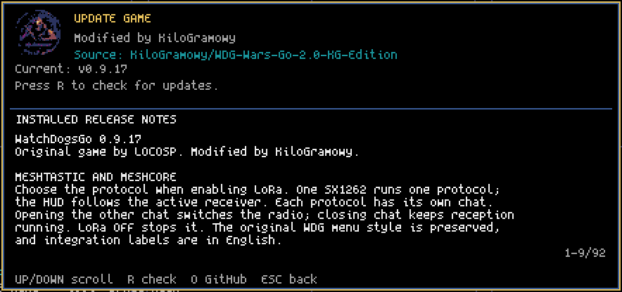

The game checks this fork in the background at each launch. A published release gets **one** main-screen notice: **OK** opens its notes; **No / Esc** lets you carry on. The notice is remembered across restarts. The next approved release can show a new notice, and **Update Game stays white** while a confirmed update remains available.

*One heads-up per release. Your cyberdeck does not need a daily newsletter.* 🔕

Opening the notes never installs an update. Installation needs a separate confirmation, stops game-owned operations, saves final data and creates a code backup. Local edits and dependency changes are checked before applying code; settings, keys, contacts, logs and player progress are preserved. A failed network check is shown as a failed check.

🔗 **Know your update source:** the window shows the verified repository; press **O** to open it on GitHub. The updater follows its permanent repository ID when the review suffix is removed. Installed release notes remain available offline. See [Updating](docs/UPDATING.md) for the release and recovery contract.

## 🎮 What is WatchDogsGo?

**Watch Dogs Go was created by [LOCOSP](https://github.com/LOCOSP).** It is a Pyxel-based, open-world cyberdeck RPG that brings real hardware observations into a Watch Dogs-inspired interface. KG Edition builds on **WDG 0.9.16**; the original game, MeshCore messenger, maps and progression are LOCOSP's work.

Explore with a uConsole and compatible hardware, see discoveries on the map, save session loot, collect XP, advance through ranks and earn badges. The game combines the map, radar, live OUTPUT terminal and keyboard-driven cyberdeck menus.

| | The original WDG experience |
| --- | --- |
| 🗺️ **Explore** | GPS tracking, map navigation, device markers and downloadable offline map tiles. |
| 📶 **Discover** | WiFi/BLE scanning with compatible ESP32 firmware and optional radio integrations. |
| 💾 **Collect** | Session logs, saved discoveries and the loot database. |
| ⭐ **Progress** | Persistent XP, 20 ranks, achievements and hacker-hat activity classification. |
| 🌐 **Connect** | Optional WDGWars community synchronization. |
| 🧩 **Extend** | Existing optional Flipper, SDR and other addon functionality. |

💡 **PWN is a game interaction, not proof of a network break-in.** It is separate from handshake capture and saved capture evidence. The inherited application also contains active security tools; the WiFi/BLE schedule above does not automatically run them.

### 🙏 Who made what?

- 🎮 **Original Watch Dogs Go, game/UI and upstream features:** [LOCOSP](https://github.com/LOCOSP).
- 🛠️ **KG Edition integration, local AUTO GPS, scan/upload fixes and field demo:** [KiloGramowy](https://github.com/KiloGramowy).
- 🧩 **MeshCore, Meshtastic, LoRaRF, Pyxel and dependencies:** their respective authors and communities.
- 📜 **Source license:** [MIT](LICENSE), with the original LOCOSP notice retained. Assets and music keep their [own terms](THIRD_PARTY_NOTICES.md).

## 🚧 To be continued… more is coming! 🔜

**KG Edition is still being developed.** We are continuing work on more features, field testing and refinements to the mesh and wardriving experience. This is the current set of improvements, with more updates planned. 🛠️📡🛰️

Future work will be documented as it is implemented and checked. More field tests, more refinements, more reasons to take the uConsole outside. **Stay tuned!** 📡

## 🧪 Validation at a glance

| Check | Recorded result |
| --- | --- |
| 📡 SFNarrow RX | Real public traffic received on uConsole around San Fernando, Spain. |
| 💬 Background text RX | Received and stored with the chat closed. |
| 📨 Public text TX | Local TX_DONE recorded; remote delivery was not established. |
| 🔁 WiFi / BLE | Seven complete WiFi and seven BLE phases on XIAO ESP32-C5 / JanOS 1.7.0, with GPS and CSV output. |
| 📤 Upload repair | Complete live accounting and persisted receipts; zero pending after restart in that check. Later captures can requeue. |
| 🔋 Shutdown on uConsole | Three isolated real-device exit cases; final ESP32 STOP acknowledged, radio workers/serial closed, all managed AIO power OFF. |
| 🧰 Software checks | Release 0.9.17: uConsole **566 PASS / 0 SKIP**. Windows: 566 cases, OK with 14 platform/fixture skips. Update and rollback flow checked separately. Earlier receiver/SPI baseline: **49 PASS**. |

The release includes the tested shutdown fix and updater. Screenshots show UI states; they do not independently prove RF reception, approved AUTO operation or chat delivery. Not every preset, region or US RF/antenna configuration has been physically validated.

🔬 **[Evidence and test limits →](docs/VALIDATION.md)**

## 🛠️ Hardware and installation

| Component | Used for |
| --- | --- |
| 🖥️ uConsole / compatible Linux graphical environment | WDG interface, designed around the 640×360 game view. |
| 📶 ESP32-C5 + compatible projectZero / JanOS firmware | WiFi/BLE and inherited ESP32 features; live fork tests used JanOS 1.7.0. |
| 📡 AIO v2 SX1262 + suitable antenna | Real MeshCore / Meshtastic LoRa reception and transmission. |
| 🛰️ Working GPS receiver / configured UART | Measured positions and AUTO GPS; MANUAL works without GPS. |
| 🌐 Optional WDGWars account/API key | Community sync; not required to open the game. |

### 📥 Install a separate checkout

📥 These commands use the final release address. During private review, use the current clone URL from GitHub's **Code** button; repository access and Git authentication are required. These commands select this fork; an upstream installer installs the original project instead.

```bash
mkdir -p ~/python
git clone --branch main --single-branch \
  https://github.com/KiloGramowy/WatchDogsGo-KG-Edition.git \
  ~/python/WatchDogsGo-KiloGramowy
cd ~/python/WatchDogsGo-KiloGramowy
bash setup.sh
./run.sh
```

💾 Keep an existing installation in its own folder and back up current data/configuration first. Separate checkouts can share home-directory `.watchdogs_*` settings and RF approvals. Preserve `loot/`, `secrets.conf`, `plugins/.wardrive_state.json`, identity/key files and mesh/radio settings. Roll back code without replacing newer progress.

📻 Use one owner per radio. The launcher uses sudo and attempts to stop `meshtasticd`; coordinate that service before launching WDG. Tested LoRaRF: **1.4.0**; CM5 GPIO uses rpi-lgpio. Other driver/kernel combinations, RF layouts and antennas need their own checks.

### 🔄 Update this fork

```bash
cd ~/python/WatchDogsGo-KiloGramowy
git remote -v
git branch --show-current
git pull --ff-only
# Re-run setup.sh if dependencies changed, then restart the game.
```

The commands above are for a separate development checkout. The in-game updater uses this fork's explicit approved-release feed, independently of a legacy installation's Git origin/HEAD. It does not run `git pull` on the installed game. Read [Updating](docs/UPDATING.md) before releasing or recovering an update.

### 🧰 Existing software checks

```bash
cd ~/python/WatchDogsGo-KiloGramowy
.venv/bin/python3 -B -m unittest discover -s tests -v
.venv/bin/python3 -B -m unittest test_meshtastic_rx_probe test_spi_mutation_regression
```

Optional driver sources/private replay fixtures can cause skips. Software checks do not replace a physical RF test.

## 📚 Read more

- 🕹️ [Feature guide and everyday controls](docs/FEATURE_GUIDE.md)
- 🛰️ [RF catalog and local AUTO GPS](docs/RADIO_PROFILES.md)
- 🧪 [Validation and hardware evidence](docs/VALIDATION.md)
- 🛠️ [Inherited WDG guide](docs/GUIDE.md)
- 🎞️ [Demo provenance, privacy edits and music credit](docs/media/README.md)
- 📦 [Private release preparation](docs/RELEASE_PREPARATION.md)
- 🙏 [Third-party notices](THIRD_PARTY_NOTICES.md)

### 🎵 Demo soundtrack

Music from **#InAudio**: https://inaudio.org/

**Infraction — Venom (Rave), Instrumental** — [track](https://inaudio.org/track/venom-rave/) · [free-use terms](https://inaudio.org/license-terms/). Edited excerpt with adjusted duration, fades and volume; separate from the software's MIT license.
