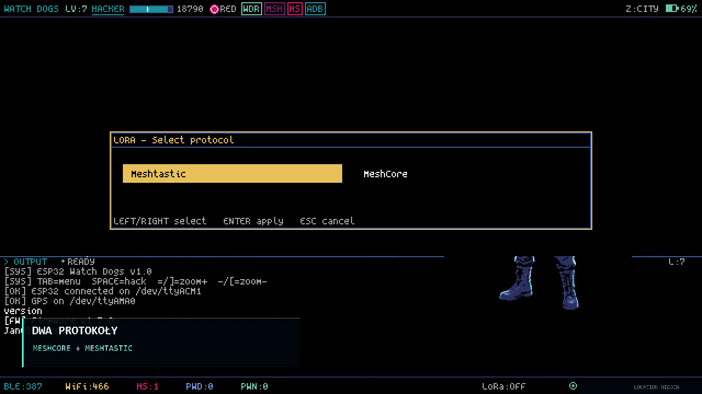

# Watch Dogs Go — historical uConsole demo

[Watch the 100-second demo](demo.mp4). The montage uses the real uConsole UI recorded on **29 October 2026**, with the user's original startup theme and a historical upload screenshot. It predates the later AUTO GPS windows and alternating WiFi/BLE wardrive changes.

The chat/game stills and silent [protocol preview](protocol-preview.gif) come from the approved recording. Startup, RF-menu and updater images show the current deployed interface; the RF-menu illustrations use isolated display data with the radio off. Public conversations, nicknames, contact names and public NodeIDs are intentionally retained at the owner's request. Exact GPS is hidden, including coordinate-looking text baked into the startup artwork; no visible authentication key or PIN was identified in the inspected recording scenes. Location masks are editorial overlays. No example messages, packet counts, delivery indicators or UI states were invented.

| File | Recording time | What it shows |
|---|---:|---|
| [demo-poster.png](demo-poster.png) | 29.0 s | Original SYSTEM/LoRa menu and game art. |
| [system-lora.png](system-lora.png) | 29.0 s | Same authentic menu, retained as a separately named still. |
| [protocol-selector.png](protocol-selector.png) | 35.5 s | Manual Meshtastic/MeshCore selection. |
| [meshcore-chat.png](meshcore-chat.png) | 44.0 s | Archived public chat with original public messages and names. |
| [meshtastic-chat.png](meshtastic-chat.png) | 63.0 s | Retained RX/local-TX history with original public content. |
| [meshtastic-nodes.png](meshtastic-nodes.png) | 74.0 s | Saved public contacts with original names, count, RSSI and ages. |
| [background-rx.png](background-rx.png) | 80.0 s | Main-screen radio status after leaving chat; public node labels retained. |
| [upload-confirmation.png](upload-confirmation.png) | 89.0 s | Original screenshot counters: 10 received, 10 new, 10 Meshtastic, DONE. |

The film keeps its original short glitch transitions and Polish editorial captions. The first ten seconds reproduce the installed original Plymouth animation from its assets; they are not a new physical boot test. Coordinate-looking text baked into that startup artwork is also hidden. The upload card reproduces a dated screenshot, not a newly performed upload. Chat history, a local TX entry and a saved contact do not establish a new RF reception, remote message delivery or present-day coverage.

## Credits and separate media terms

Original **Watch Dogs Go** game and upstream UI: **LOCOSP**, copyright 2025–2026, MIT; preserve the repository's [LICENSE](../../LICENSE). Fork/integration work and demo montage: **KiloGramowy**. Existing upstream game artwork is shown as recorded; this media package does not claim new authorship or a separate blanket license for third-party artwork or trademarks.

Music from #InAudio: https://inaudio.org/

**Infraction — Venom (Rave), Instrumental**

https://inaudio.org/track/venom-rave/

Edited excerpt: duration, fades and volume adjusted for this video. Free-track video use requires this track-link attribution in the video description. See the publisher's [license terms](https://inaudio.org/license-terms/). Preserve these credits beside any copy/link of the audible demo. The track is not public domain and is not licensed by the repository's MIT license. No standalone soundtrack, source WAV or music-download archive is included. The GIF and PNGs are silent.

The [media manifest](media-manifest.json) records relative asset paths, hashes, extraction times and privacy edits. The original source recording and private QA files are not included. Public recorded chat/contact content is retained by request; configuration secrets, player-data exports and exact GPS are not included.

## Later hardware menu captures

These supplementary screenshots are actual uConsole captures, separate from the older video:

- [English Meshtastic RF dialog](rf-meshtastic.png) and [English MeshCore RF dialog](rf-meshcore.png): 29 October 2026, source `25e4fcc`. Cropped to the dialogs to exclude the surrounding HUD/OUTPUT; nearest-neighbor enlargement only.
- [WiFi and BLE both selected](wifi-ble-menu.png): 30 October 2026, source `4fd571c`. The original menu-only capture shows both ON selections. The phase traces documented in [validation](../VALIDATION.md) establish the alternating scan sequence.

The [supplementary source manifest](supplementary-menu-manifest.json) records capture hashes and crop dimensions. No UI text, counters or radio state were invented for these images.

## README presentation update — 1 November 2026

The main README keeps the approved WDG SYSTEM/LoRa hero and feature descriptions. Startup and update-window images now show the deployed interface, including the KiloGramowy credit and avatar.

- `wdg-startup.png` and `wdg-loading.png`: the deployed WDG startup screen, with the credit close-up and full loading view. Original UI pixels are retained.
- `protocol-selector-detail.png`: an unscaled 884×184 crop of the recorded selector (35.5 s), bounding box [198, 238, 1082, 422], for readable Meshtastic/MeshCore labels.
- `auto-save-preview.png`: the current WDG RF dialog renderer with isolated zero-coordinate display data. The source fixture has no GPS/radio use and creates no user approval. The README explicitly labels this illustration; it is not a successful live AUTO claim.

The GitHub-native player uses a smaller H.264/AAC copy of the complete reviewed film. The original full-quality `demo.mp4` remains available in this folder. The attachment inherits the same GPS masks, public-chat/node visibility choice and soundtrack terms.

[Open the native GitHub video player](https://github.com/user-attachments/assets/047f3c2f-ffb4-4a24-8871-52a9a8577e9c). The attachment was uploaded in this private repository context. It is the same full 100-second edit, encoded as a 9,190,468-byte H.264/AAC copy for GitHub. The README player uses this permanent attachment address, not an expiring signed media URL.

The current RF-menu images retain the existing typography and layout. `update-game.png` shows the deployed 0.9.17 Update Game window on uConsole with isolated player state and a real private release-source check, cropped above OUTPUT. Source hashes and crop bounds are recorded in the supplementary manifest.
