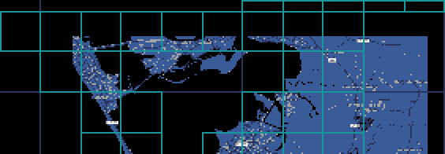
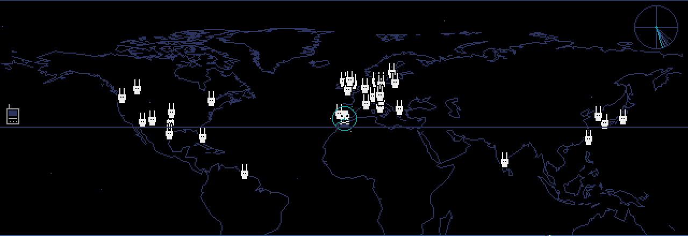

RELEASE 0.9.21 - LET THE MAP FOLLOW. SPOT THE RABBIT. KEEP THE LOOT.

**🗺️ Your map grew legs. 🟩 Gang turf got its borders. 🐇 White Rabbit finally showed its ears. 🏅 Portal badges found a trophy shelf. 📡 Wi-Fi + BLE stopped making the screen queue for paperwork.**

The 0.9.20 Piglet brought home the CSV. In 0.9.21, the map has decided to come along for the walk. Nobody asked your CPU to carry the filing cabinet. 😏

Original game and JanOS by **LOCOSP**. Modified by **KiloGramowy**.

## 🗺️ Auto Map + Turf — your map finally learned to walk

❌ **Before:** another street meant another trip to **Download Map**. Nearby WDGWars gang territory had no automatically downloaded layer on your map.

✅ **Now:** **TAB → SYSTEM → Auto Map + Turf → Enter** enables automatic downloads of **both** street-map tiles and nearby WDGWars sectors as you move. **Default: OFF** for existing players; your choice survives a restart. The familiar manual **Download Map** stays exactly where it was.

- 🗺️ **Roads:** download a **10 km** neighborhood; after moving **3 km** from the last completed center, the next neighborhood is considered. Already saved tiles aren't downloaded twice.
- 🟩 **Turf:** nearby sectors refresh after **five minutes** when the server and your key are available. Entering a new region fetches missing adjacent territory.
- 🔑 **Your keys, your rules:** street tiles still use the existing **Stadia Maps key**; gang sectors use your existing **Wars Sync API key**. Each layer can work independently if only its own key is configured.

Automatic fetching follows **fresh, measured GPS younger than two seconds**. Dragging the map, retaining a stale fix or using SOLO's separate backfill cache will not persuade it that you've teleported. Without fresh measured GPS, no new automatic area is requested.

**Default street-basemap credits:** © [Stadia Maps](https://stadiamaps.com/attribution/) · © [OpenMapTiles](https://openmaptiles.org/) · © [OpenStreetMap contributors](https://www.openstreetmap.org/copyright).

> 🐕 You do the wardriving. Your map can do the homework.

**📷 Auto Map + Turf — map coverage preview**

*Owner-supplied illustrative preview; not a recorded GPS position or physical-device acceptance test.*

## 🟩 WDGWars turf — welcome to the neighborhood

❌ **Before:** you could visit the street, but the local map didn't show the gang squares automatically.

✅ **Now:** with **Auto Map + Turf ON**, zoom **9 or closer** shows saved, gang-colored **sector outlines** over the existing streets or grid. The live radio and game markers stay visible. Gang names and ownership come from WDGWars, with colors adapted to Pyxel's 16-color palette.

An occupied sector under a fresh measured position can show the **OWN / TURF** hint. An **asterisk (*)** means the saved ownership snapshot is older than five minutes. Offline colors are last-known information, not a live ownership certificate.

And no, walking across a square does **not** magically capture it or award XP. The server is the referee. Your shoes are not a capture API. 👟

## 🐇 White Rabbit — the ears are finally on the map

❌ **Before:** public 0.9.20 had no White Rabbit markers. The API work in private 0.9.21 DEV still kept the rabbits offstage until the map integration arrived.

✅ **Now:** **white bunny markers appear automatically** on the existing map for server-reported **open, unclaimed, unexpired** targets. Pan and zoom as usual. No new rabbit window or extra key.

With your existing Wars Sync account, the game checks at startup and **at most once every 60 seconds**. Rabbit reads work **independently of GPS and Auto Map + Turf**; the server supplies target coordinates, and these reads send no player GPS. A successful snapshot is kept for the same account; expired targets disappear offline, and claimed/caught ones disappear after the next valid response. Cached availability can be out of date.

This is a **map marker**, not a new capture mechanism, hacking action or XP award. **Game State and Device Pairing remain API clients**, **without new Game State or interactive pairing screens**.

> 🥕 The rabbit brought its coordinates. You bring the curiosity.

**📷 White Rabbit — global map preview**

*Owner-supplied illustrative preview; not a live server or device-GPS validation.*

## 🏅 Portal Badges — no trophy left behind

❌ **Before:** server-owned badges that didn't match a native achievement had no complete shelf in the game.

✅ **Now:** **TAB → PLUGINS → Watch Dogs Go Wars Sync → Portal Badges → Enter** shows the account's complete returned server-owned badge list. Browse with **Up / Down**, **Page Up / Page Down**, **Home / End**; **R** performs a **read-only GET** refresh; **Esc** returns to Sync.

Names and descriptions come from the portal when available; otherwise the badge keeps a readable identifier. Cached ownership is tied to the selected account. This list stays **separate from native achievements** and does not create awards, send a badge POST or mint XP.

> 🏆 If the trophy cabinet was too small, we fixed the cabinet. We didn't invent trophies.

## 💾 Offline pockets — download once, keep the streets

❌ **Before:** expanding offline coverage beyond your manually saved tiles meant another manual download.

✅ **Now:** successful automatic downloads join the existing local map cache. Already saved tiles and turf snapshots can be viewed without internet; an uncached neighborhood still needs a connection. When a tile request fails, the automatic batch stops at its first error, retains successful downloads and retries later. Failed territory reads never erase the last good snapshot.

Turning **Auto Map + Turf OFF** stops future automatic requests and hides turf **without deleting saved data**. Manual Download Map keeps its existing behavior. Invalid settings/cache entries are handled safely rather than deleting the file.

With the option ON, the last completed saved automatic center can also restore the **initial map view after a restart without fresh GPS**. That's a view, **not** a GPS fix: it cannot trigger automatic downloads, RF AUTO or SOLO backfill. The first automatic neighborhoods don't cover polar limits or dateline crossings.

> 📦 Offline means you keep what you've downloaded. It does not mean the internet owes you the next city.

## 🛡️ Firmware KG/SOLO — our fork, not a stock surprise

❌ **Before:** stock JanOS update hints and the older flashing route could point a KG/SOLO player toward firmware without the SOLO extension.

✅ **Now:** **SYSTEM → Firmware KG/SOLO** checks the **KG Edition release repository** when the connected board reports its version and after reconnect. Press **R** to refresh. The panel shows detected/latest KG firmware and its source. Its version comes from the **firmware manifest**, not the game Release number.

The current approved KG package is **JanOS 1.7.0 + SOLO** for the documented compatible XIAO ESP32-C5 revision 1.0 / 8 MiB app-only layout. The device displays **KG 1.7.0**: that's a host label for the reported version, not a new flashed firmware or proof of features by itself.

**Enter starts a manual KG firmware installation or reinstall** after compatible-package and board checks. **Esc closes the window; an installation already underway continues.** **Automatic checking does not flash automatically.** A failed or incompatible package is refused, with no fallback to stock JanOS or Piglet. Reconnect requests a fresh board version; a refused pre-write operation attempts to return the same board to its original application instead of pretending an installation succeeded.

**Update Game remains game-only. No firmware gets flashed by updating to 0.9.21.** The new manual KG flashing/recovery route was not physically exercised in this candidate's device validation.

> 🐷 Stock firmware can mind its own business. SOLO has a seat on this bus.

## 📡 Wi-Fi + BLE — stop making the map wait for the paperwork

❌ **Before:** busy scanning or even an idle Collection check could block the screen behind storage work. Large progress saves and repeated serial processing added delays; a damaged message prefix could hide a complete later observation.

✅ **Now:** everyone upgrading to **0.9.21** gets the host-side responsiveness fixes **automatically, with no new switch**.

- ⚡ **The GUI keeps moving:** scan presentation and idle Collection checks yield instead of waiting for busy storage. Incoming work is handled in smaller batches.
- 💾 **Less write drama:** large progress is prepared compactly and written in one pass, retaining the existing durable-save, recovery and XP rules.
- 📶 **Less serial busywork:** bursts are split once and an artificial **100 ms** command wait is removed. **START and STOP still need real acknowledgements**; RF profiles and scan timings are unchanged.
- 🧾 **No imaginary packets:** a complete valid observation after a damaged prefix can be recovered. Partial or missing observations are not reconstructed; sequence gaps are reported instead of swept under the carpet.

The result is less waiting, not a promise of zero lag or lossless RF forever. No new firmware, radio mode or XP scheme comes with this host fix.

> ☕ Your CPU can stop filing one CSV while the map waits at the counter. The hunt has other plans.

## 🗑️ Pending Upload Logs — sent or not, your CSV, your call

❌ **Before:** confirmed-upload status could block manual deletion, and the list did not make the sent/not-sent choice clear enough.

✅ **Now:** **PLUGINS → Pending Upload Logs** shows **SENT / NOT SENT** for each export. Select one **closed CSV**:

- **SENT → D:** immediately deletes that selected local CSV, **without another confirmation**.
- **NOT SENT → D:** warns that the file **has not been uploaded**. **Y** confirms deletion; **N / Esc** keeps it. This includes a closed no-GPS export that cannot be uploaded.

**Only that CSV export is removed.** Saved XP, progress, contacts and existing server receipts stay. Deletion does not count as an upload or invent server credit. The current writing session and files protected by an active upload remain protected.

**Auto-clean keeps its existing rules and your chosen setting.** This is your manual decision, not permission for automatic cleanup to discard unconfirmed data.

> 🧾 The filing cabinet has a delete button. Your loot does not.

## 🧹 Auto-clean — count from the upload, not the road trip

❌ **Before:** fully confirmed exports could miss cleanup eligibility when their supported upload contained duplicates or leftover no-GPS rows. An old session date or an uploaded flag could not prove when an upload was actually confirmed.

✅ **Now:** in **Pending Upload Logs**, press **A** for Auto-clean. Keep your existing choice of **Keep all / 1 / 5 / 15 / 31 days / custom**. Use **Up / Down → Enter** to apply or **Esc** to cancel.

**After 5 days means five elapsed days from the first recorded complete upload confirmation**, for the same unchanged file and account. Batched uploads must finish all required acknowledgements first. Restarting or checking the same proof again does **not** restart the clock; the log's capture date and file-modification time are not upload dates.

Legitimate duplicates and leftover no-GPS lines can coexist with a fully acknowledged supported upload; they no longer strand that otherwise eligible export. A no-GPS-only **NOT SENT** export does not get a confirmed-upload retention clock; its existing manual **D** choice remains. Structurally invalid or unreadable files stay protected from this retention cleanup.

**No invented birthdays:** a legacy uploaded flag without a usable acknowledgement time does not prove five days have passed. Old files are not backdated into automatic expiry. XP, contacts, receipts, unsent data and active/upload protections remain; **Keep all** still means keep all for this retention policy.

> 🗓️ The calendar follows the receipt. It does not interrogate the filename.

## 📦 Wardriving Collection — one desk, two CSV dialects

❌ **Before:** the 0.9.20 receiver understood Piglet KG's fourteen-column WiGLE 1.6 CSV.

✅ **Now:** **WARDRIVING → Wardriving Collection** keeps that Piglet path and also accepts supported **Dark3D WiGLE 1.4 eleven-column `.log` files**. Original bytes, supplied GPS/time and metadata stay attached; unknown fields stay unknown. Typed authenticated peers show **PIGLET KG CONNECTED** or **C5 WARDRIVER CONNECTED**, with the existing **30-second** activity expiry. Hotspot readiness is a separate status.

The existing **PC1 protocol, durable ACK, whole-file import and deduplication** stay. Repacked duplicates, retries and restart cannot pay the same observation twice. These are host compatibility checks, **not a new physical Dark3D sender/transfer validation or a supplied Dark3D firmware build**. **The modified Dark3D Collection sender firmware is not publicly available in this RC; it requires its own separately approved release.** Official stock .13 alone is not a supplied Collection sender. Multiple physical Piglets are still unsupported.

**Dark3D C5 UConsole firmware — documentation and future `.bin` downloads:**
https://github.com/KiloGramowy/Dark3D-C5-Wardriver-UConsole
**Currently PRIVATE:** no public `.bin` until its separate Release is approved and published.

> 🧾 Two CSV dialects. One receipt desk. The loot does not need a second payroll.

## 🐷 Same SOLO. Same Pig. Same loot.

These are **existing 0.9.20 features**, not new inventions in 0.9.21: WARDRIVING SOLO, Piglet Collection, independent Wi-Fi/BLE choices, GPS trail, Startup GPS Backfill, the **720-minute** accepted-position cache, uploads and their durable receipts.

The reward rules remain **15 XP** for new Wi-Fi, **10 XP** for new BLE and **1 XP** for repeats. Saved XP, levels, history, contacts, keys, local settings, pending uploads and selected Auto-clean policy keep their existing meaning. No XP recalculation, new automatic external upload or firmware flash.

Multiple physical Piglets remain unsupported pending the existing device-identifier fix and hardware validation.

> 🐖 Piglet keeps the deliveries. SOLO keeps the hunt. Your loot stays yours. No witness-protection program required.

## 🧪 We tested it — the receipts, not the victory dance

**Fresh RC checks are recorded separately against an exact source commit in the private validation report.** The earlier totals below are historical, before the final log-deletion/retention and combined Wardriving Collection candidate; they are not a fresh full pass of this RC. No new physical uConsole test is claimed.

**Earlier shared scan/Collection software baseline:** Linux/uConsole **1,679 PASS / 0 SKIP / 0 FAIL**; Windows **1,665 PASS / 14 platform/root SKIP / 0 FAIL**. All 14 Windows skips passed on Linux. All **164 tracked Python files** compiled in both environments. Piglet/SOLO checks and other isolated tests are separately documented.

**Physical uConsole:** a genuine measured GPS fix fetched **nine territory regions / 57 cells** with colored outlines; real White Rabbit markers and the Portal Badges list appeared in the running GUI. Previously cached tiles and the last completed automatic area reappeared after a no-fix restart. That restart had internet available: it's not a full network-outage test.

**Keeping the hunt moving:** a bounded **120-second** device run recorded **480 samples**, **3,445 frames**, no sampled second-long GUI pause and a maximum observed frame gap of **151.93 ms**. Three closed Wi-Fi/BLE captures accounted for **1,150 received = 1,150 durably saved = 1,150 STOP-confirmed** observations, with zero observed sequence gaps **in those captures**. Earlier gaps remain historical; the test is not a guarantee of lossless reception in every environment.

**Your progress matters:** the device preservation checks passed **35/35**. Real existing upload submissions received actual server acknowledgements; no synthetic observations or test XP were sent to the real profile. Private device-specific data and owner-only integrations are not part of this release description or package.

**Still NOT VERIFIED:** physical **3 km** relocation, complete internet loss and recovery, a new physical Piglet transfer, live interactive Device Pairing, every RF configuration, or flashing/recovery through the KG firmware client. No firmware was flashed for this update.

> 🧪 The suite did the paperwork. Earlier uConsole checks kept their own receipts. Neither gets to claim a marathon from a two-minute run.

## 🔄 Update Game — one decision, no surprise flash party

**WDG Wars Go stays fully open source.** The existing verified **Git/source updater** remains the update route; the complete KG game changes stay available as source with the original license and notices. No new installer or plugin architecture is needed.

When an approved compatible update is published, open **TAB → SYSTEM → Update Game**, press **R** to check and **Enter** to prepare. Read the notes. **Y** confirms installation; **N / Esc** cancels before installation. Opening release notes alone never installs anything.

Updaters **0.9.19.1 onward** restart automatically after a successful update. Running **0.9.17 / 0.9.18 / 0.9.19** needs one manual relaunch on its first upgrade. A failed/cancelled preparation does not restart the game. ZIP sources and locally modified installations require their documented migration/reconciliation steps. **Game OTA never flashes JanOS or Piglet.**

📦 [Release 0.9.21](https://github.com/KiloGramowy/WDG-Wars-Go-2.0-KG-Edition/releases/tag/v0.9.21) · 📝 [All releases](https://github.com/KiloGramowy/WDG-Wars-Go-2.0-KG-Edition/releases)

📚 [Game update and recovery guide](https://github.com/KiloGramowy/WDG-Wars-Go-2.0-KG-Edition/blob/main/docs/UPDATING.md)

**LET THE MAP FOLLOW. SPOT THE RABBIT. KEEP THE LOOT.** 🐕🗺️🐇
