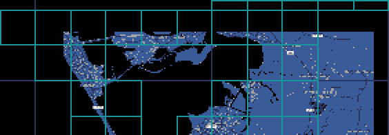
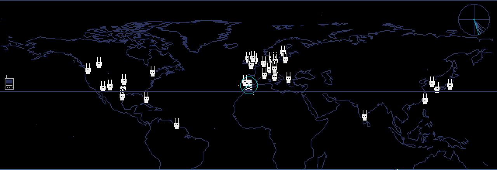

# 0.9.21 README feature-copy preparation record

This records the 0.9.21 feature copy used for the README. Historical physical
observations retain their scope. The [Latest update text](README_LATEST_UPDATE_DRAFT.md)
replaces the previous banner above the retained feature-tour video; it is not
an additional historical banner.

## 🗺️ New in 0.9.21 — follow the roads, know the turf

*Your map has learned to pack ahead. You still have to remember your own shoes.* 👟

❌ **Before:** extending street-map coverage required **Download Map**, and no
automatic local WDGWars gang-sector layer followed measured GPS.

✅ **Now:** **TAB → SYSTEM → Auto Map + Turf → Enter** enables both background
layers. **Default: OFF; choice remembered.** The map uses a **10 km radius**
and considers a new area after **3 km** from the last completed center; nearby
sectors refresh after **five minutes** when fresh GPS, the required key and
server are available. **Manual Download Map stays.**

At zoom **9 / NEIGHBORHOOD or closer**, saved gang sectors appear as coloured
**outlines** over the existing map. Colours use the game's 16-colour palette.
A cached occupied measured-GPS sector can show **OWN / TURF**; **`*` marks a
snapshot older than five minutes**. Walking into a square does not capture it.

Tiles require the existing **Stadia Maps key**; sectors require **Wars Sync**.
Successfully downloaded data stays local for cached viewing. OFF stops automatic
area requests and hides turf without deleting its cache. With ON and no fresh
fix after restart, the last completed saved automatic center can supply the
**initial view**. It is not a GPS fix and cannot drive automatic downloads,
RF AUTO or SOLO backfill. A new area still requires a measured sample younger
than **two seconds**.

**Default street-basemap credits:** © [Stadia Maps](https://stadiamaps.com/attribution/) · © [OpenMapTiles](https://openmaptiles.org/) · © [OpenStreetMap contributors](https://www.openstreetmap.org/copyright).

*0.9.21 map illustration supplied by the owner; not evidence of live GPS or a new device test.*

## 🐇 White Rabbit — spot the ears

*The rabbit brought coordinates, not a free capture button. Follow the ears.* 🥕

❌ **Before:** public 0.9.20 had no rabbit markers; the API client introduced
during private 0.9.21 DEV still needed its map integration.

✅ **Now:** open, unclaimed and unexpired server targets appear automatically
as **white bunny markers** on the existing map. Normal map pan/zoom applies;
there is no extra rabbit screen or key.

The existing Wars Sync account/key enables the first read and **at most one
refresh per 60 seconds**. Rabbit reads are **independent of GPS and the Auto
Map switch** and send no player coordinates. Saved targets belong to the same
account; expired targets disappear while offline, and the next good response
removes caught/claimed targets. Offline availability remains last-known data.

These are map markers. They add **no capture request, new hacking target,
local XP award or capture rule**. The bunny brings its own coordinates.

*0.9.21 map illustration supplied by the owner; not a live target availability or user-location record.*

## 🏅 Portal Badges — the whole shelf

*No trophy left behind. We enlarged the cabinet, not your XP.* 🏆

❌ **Before:** badges outside the game's native mapping had no complete
server-owned list in the game UI.

✅ **Now:** **TAB → PLUGINS → Watch Dogs Go Wars Sync → Portal Badges → Enter**
opens the account's complete returned ownership list, including IDs with no
native achievement icon. Use **Up / Down**, **Page Up / Page Down**,
**Home / End**, **R** for a read-only refresh and **Esc** to return to Sync.
Opening the list also refreshes by GET.

Names/descriptions come from server metadata when available; otherwise an ID
gets a readable **Portal badge** label. The saved list is bound to its account.
It does not award XP or create new native achievements. Existing native badge
sync and local **15 / 10 / 1 Wi-Fi/BLE XP** rules keep their meaning. Your
existing Wars Sync key is used; no new local API server is installed.

## 🛡️ Firmware KG/SOLO — the right source for the board

*Stock firmware can keep its version numbers. SOLO keeps its seat.* 🐕

❌ **Before:** stock upstream version alerts and the old Flash ESP32 route
could point KG users at JanOS without SOLO.

✅ **Now:** **SYSTEM → Firmware KG/SOLO** checks **our KG Edition repository**
when the connected board reports its version and after reconnect. **R** refreshes
the check. The panel shows **Detected KG**, **Latest KG** and the KG source.
The firmware version comes from its manifest, not the game's Release tag:
the published game **0.9.20** currently carries **JanOS 1.7.0 + SOLO**.

**Enter** starts a manual installation/reinstall of a verified compatible KG
package. **Esc** closes the panel; a running installation continues. There is
**no automatic flash** and no stock JanOS/Piglet fallback. Older packages and
unverified hardware/layout combinations are refused; a missing or invalid KG
package is reported rather than replaced with another firmware source.

The approved [published KG/SOLO package](https://github.com/KiloGramowy/WDG-Wars-Go-2.0-KG-Edition/blob/v0.9.20/firmware/wardriving-solo/README.md)
is application-only for the specific **XIAO ESP32-C5 revision 1.0 / 8 MiB**
board/layout. Downloads are checked before board access. **Update Game remains
game-only; WDGWars keeps its existing API path.**

The **KG 1.7.0** host label changes display text, not firmware. Raw serial logs,
the numeric version and actual SOLO capability checks retain their meaning;
the label alone does not prove SOLO support.

## 📡 Shared Wi-Fi + BLE correction — automatic in 0.9.21

*The map is here to hunt, not to queue at the CSV filing desk.* ☕

❌ **Before:** combined scan traffic or an idle Collection check could make the
map/menus wait for storage. A damaged board message could hide a complete
observation following it.

✅ **Now:** everyone upgrading to 0.9.21 gets the host correction automatically;
**there is no new toggle**. Busy scan presentation and Collection checks defer
work, large saves use one compact write pass and incoming bursts are split once.
Commands omit an artificial **100 ms** wait while preserving actual board
START/STOP acknowledgements and the existing scan profiles/timings.

Only a complete valid follow-up observation passes resynchronization; partial
or absent records are not reconstructed. STOP diagnostics keep sequence gaps
visible. **No blanket lossless/zero-lag guarantee and no firmware flash.**
The earlier shared scan candidate passed 1679 Linux software methods; Windows
passed 1665 with 14 platform/root skips, covered by Linux. Those historical
results precede the final combined RC and are not its fresh validation.
A bounded physical 120-second combined-scan window showed no sampled second-long
frame gap; three closed captures accounted for 1150 raw/durable/STOP observations
with zero observed gaps or malformed messages. Status telemetry sometimes lagged;
this is not universal FPS or lossless reception, or recovery of old missing rows.

## 🗑️ Pending Upload Logs — sent or not, keep the loot

❌ **Before:** confirmed-upload status could block manual deletion, and the
list did not make the sent/not-sent choice clear enough.

✅ **Now:** **PLUGINS → Pending Upload Logs** shows **SENT / NOT SENT**.
Select one **closed CSV**:

- **SENT + D** immediately deletes the selected CSV, without confirmation.
- **NOT SENT + D** warns that it was not uploaded; **Y** deletes it,
  **N / Esc** keeps it. Closed no-GPS exports that cannot upload are included.

Only the selected local CSV is removed; saved XP, progress, contacts and server
receipts remain. Current writing sessions and active-upload locks stay protected.
Deletion is not an upload confirmation or new server credit. **Automatic cleanup
keeps its existing eligibility rules and your Auto-clean choice.**

*The CSV can leave the filing cabinet. Your loot stays home.* 🧾

## 🧹 Auto-clean — give the receipt the calendar

❌ **Before:** complete supported uploads with duplicate/no-GPS leftovers could
miss cleanup eligibility; a legacy flag or old log date could not prove upload age.

✅ **Now:** **Pending Upload Logs → A** retains **Keep all / 1 / 5 / 15 /
31 days / custom**. **Up / Down → Enter** applies; **Esc** cancels.
**After 5 days** means five elapsed days after the first recorded complete
upload confirmation for the unchanged file/account. Batched uploads need all
required ACKs; rechecking or restarting does not restart that clock.

Legitimate duplicates/no-GPS leftovers may remain in a fully acknowledged
supported export. A pure no-GPS **NOT SENT** file has no confirmed-upload
retention clock and keeps the existing manual D choice. Structurally invalid
or unreadable files are retained. Legacy flags without usable ACK times cannot
be backdated from capture dates or file timestamps. Progress, receipts,
active/upload protection and the chosen retention option remain.

*Dates belong on receipts. Guesswork belongs in the rabbit's alibi.* 🐇

## 📦 New in 0.9.21 — Wardriving Collection, one receipt desk

❌ **Before:** Piglet KG WiGLE 1.6 fourteen-column CSV was the receiver's input.
✅ **Now:** **WARDRIVING → Wardriving Collection** also accepts supported Dark3D
WiGLE 1.4 eleven-column `.log` files, retaining original bytes and supplied GPS,
time and metadata. Typed authenticated peers use **PIGLET KG CONNECTED** or
**C5 WARDRIVER CONNECTED**, with the existing **30-second** expiry; hotspot
readiness is separate. PC1, durable ACK, whole-file deduplication and existing
XP rules remain. This is host compatibility, not a new physical sender test
or a Dark3D firmware package. Modified Dark3D Collection sender firmware is
not publicly supplied and awaits its own separately approved release. *Two dialects. No double payroll.*

📥 **Dark3D C5 UConsole firmware docs and future `.bin`:** [Dark3D C5 UConsole](https://github.com/KiloGramowy/Dark3D-C5-Wardriver-UConsole) (**currently private**; separate Release approval required).

**WDG Wars Go remains fully open source**, including the KG changes. The existing
verified Git/source updater and normal Python plugin discovery are retained.

## Historical media placement notes

- KG-client/KG-display software and physical observations have separate
  checkpoints in the private reports. Do not relabel the historical 0.9.20
  stock-wizard or interim information-only panel as the current control. Use a new KG-client capture only
  after it has actually been observed; keep old footage labelled historical.

- Use only the actual approved private physical captures and truthful captions.
  Do not invent public asset URLs before approval/upload.
- The real turf capture follows a genuine brief fix and **nine regions / 57
  cells**. A physical **3 km relocation** is not established by it.
- The earlier cached-tile capture shows **61 manual default-view tiles after
  restart with network available**, not automatic GPS downloads or full offline
  recovery. Keep that provenance if using it.
- Actual rabbit and Portal Badges captures now exist privately; no-fix cached
  initial-view restoration also passed on the real device. Keep originals and
  safe derivatives outside Git; remove location/account/pairing data from any
  approved publication derivative.
- Preserve earlier accepted SOLO/Piglet screenshots and their original evidence
  labels. Do not relabel synthetic previews as physical-console captures.
